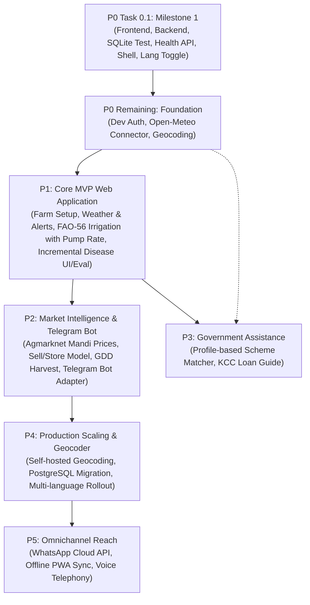

# AgriConnect: Complete GSD Architecture & Implementation Plan

> **Document Version:** v1.3.1  
> **Methodology:** Getting Shit Done (GSD)  
> **Status:** **PLANNING COMPLETE — AWAITING USER APPROVAL.**  
> **Primary Source of Truth:** `AgriConnect_Detailed_Document.pdf`  
> **Master File Location:** [`AgriConnect_GSD_Plan.md`](file:///c:/Users/Venkatesh%20A%20S/Desktop/AgriHUB/AgriConnect_GSD_Plan.md)

---

## Document Changelog

### v1.3.1 — Final Clarifications: Disease Calibration, Irrigation Provenance, Weather Fallbacks & Strict Milestone 1 Scoping
| Change Item | Affected Sections | Rationale & Architectural Impact |
| :--- | :--- | :--- |
| **1. Provisional Disease Confidence & Calibration Requirement** | §5, §10, §12 (P1), §14, §16, §17 | Clarified that any diagnostic threshold (e.g., 65%) is strictly **provisional**, not scientifically established. Mandated empirical validation and confidence calibration on field-relevant test datasets before finalizing the production threshold. Maintained robust fallback behavior (re-take guidance or local KVK escalation) for uncertain results. |
| **2. Documented Irrigation Assumptions & Pump Rate Provenance** | §4, §5, §7, §10, §12 (P1) | Explicitly designated irrigation efficiency figures (Flood: ~50%, Furrow: ~65%, Sprinkler: ~75%, Drip: ~90%) as **configurable assumptions requiring documented agronomic sources** (e.g., FAO-56 Table 21 / ICAR guidelines). Expanded pump discharge rate support to distinguish **measured**, **farmer-entered**, and **estimated** values, with clear provenance badges in recommendations. |
| **3. IMD Crop-Stage Alert Sourcing & Weather Fallback Hierarchy** | §4, §5, §6, §12 (P1), §14 | Specified the intended source for crop-stage alerts: India Meteorological Department (IMD) Agromet Advisory Services (AAS) bulletins / District Agromet Units (DAMUs via Meghdoot / IMD bulletins), combined with Open-Meteo for numerical parameters. Defined a strict multi-tier fallback hierarchy (cached forecast $\rightarrow$ 10-year district climatological normals $\rightarrow$ explicit unavailability notice with manual moisture guidance). |
| **4. Strict Milestone 1 Isolation from Remaining P0 Work** | §11, §12 (P0), §18 | Explicitly isolated **Milestone 1** to core foundation plumbing only: React frontend, FastAPI backend, SQLite connectivity, health-check endpoint (`/api/v1/health`), responsive homepage, and English/Kannada language selector. Explicitly excluded authentication, weather connectors, and geocoding from Milestone 1, assigning them to subsequent P0 tasks. |

### v1.3.0 — Final Pragmatic Refinement & Milestone Structuring
* Delineated Initial Development Stack (React, Vite, Tailwind, Python, FastAPI, SQLite, SQLAlchemy, Fetch API, Open-Meteo, Mock OTP) from Deferred Technologies (PostgreSQL, Redis, Celery, Gemini LLM, ONNX Runtime, DLT SMS Gateways).
* Structured disease detection into an incremental validation gate (upload UI first, public dataset review, lab vs. field comparison).
* Added pump discharge rate to irrigation calculations; confined market intelligence strictly to Phase P2.
* Simplified development authentication to mock OTP; established DPDP compliance realism.
* Decoupled Phase P3 (Government Schemes) dependency from Phase P2.

### v1.2.0 — Architecture Simplification & Web-First Ordering
* Shifted development order to Web Application First, Telegram Bot Second.
* Multi-language design with Kannada as the initial testing language.
* In-process caching over Redis; FastAPI background tasks over Celery.
* Standard float coordinates with Haversine distance over complex GIS extensions.

### v1.1.0 — Architecture Review Revisions
* Evaluated farmer conversational channels and WhatsApp alternative.
* Candidate Bhashini integration with empirical validation gate and Whisper fallback.
* Introduced initial DPDP Act 2023 principles and prompt-injection defense guidelines.
* Established governance for static agronomic knowledge repositories.

---

## 1. Project Vision

### 1.1 Executive Summary
**AgriConnect** is a farmer-centric, language-agnostic-at-the-core, multilingual-at-the-interface decision-support platform. Smallholder and medium-scale farmers in India make critical, time-sensitive decisions (crop selection, irrigation scheduling, disease management, harvest timing, and crop sale) using fragmented, opaque, and English-dominated data sources.

AgriConnect solves this by connecting a farmer's specific farm context (location, soil, water availability, irrigation method, pump capacity, crop growth stage) with deterministic agronomic rules, lightweight computer vision models, and verified public datasets (weather, mandi prices, government schemes).

### 1.2 Core Objectives & Guiding Principles
1. **Multilingual at the Interface, Language-Agnostic at the Core:** Designed to support multiple Indian languages (Kannada, Hindi, Telugu, Tamil, Marathi, Bengali, English). The core agricultural reasoning engines operate strictly on numerical and categorical parameters; translation lives entirely at the interface boundary. **Kannada is selected as the initial language for end-to-end testing and field validation**, after which other regional languages are enabled via translation dictionaries.
2. **Development Sequencing (Web First, Bot Second):** Development starts with a mobile-responsive web application so the complete farmer workflow can be tested and proven immediately on any smartphone browser. The Telegram bot is built subsequently in Phase P2 as a channel adapter calling the same backend endpoints.
3. **Rules-First & Explainable:** Use deterministic formulas (FAO-56 Penman-Monteith for irrigation, Growing Degree Days for crop stages) where agricultural science is established. Use Machine Learning only where pattern recognition earns its place (crop disease image detection), and only after rigorous domain-shift validation and empirical confidence calibration.
4. **Water-Aware & Farm-Aware:** The platform never assumes drip irrigation by default. It explicitly captures the farmer's irrigation method (Flood, Furrow, Sprinkler, or Drip) and pump discharge rate (distinguishing measured, farmer-entered, or estimated values). If the pump rate is available, exact pumping runtime is calculated; otherwise, only total required water volume is reported.
5. **Market-Honest (Phase P2):** Mandi market intelligence is introduced in Phase P2 after the core farm-management workflow is stable. The system displays current APMC mandi prices, nearby comparisons, and historical trends. It calculates realistic net realization for selling now versus storing produce, refusing to present speculative future prices as guaranteed.
6. **Simple & Lightweight Architecture:** A clean modular monolith built with Python (FastAPI) and React (Vite + Tailwind). Minimal moving parts, no premature infrastructure, and simple file-based configurations for initial development.

---

## 2. Architecture Overview

### 2.1 Clean Modular Monolith
The architecture runs as a single lightweight backend service and a responsive frontend web application, deployable on local machines or basic cloud instances.

```
                           +--------------------------------------------------+
                           |             FARMER INTERACTION LAYER             |
                           |                                                  |
                           |  1. Primary: Mobile-Responsive Web App (React)   |
                           |  2. Secondary (P2): Conversational Bot (Telegram)|
                           +------------------------+-------------------------+
                                                    |
                                                    v
                           +--------------------------------------------------+
                           |           MULTILINGUAL INTERFACE LAYER           |
                           |  - Language selector (kn, en initially; hi, te..)|
                           |  - Simple JSON translation files (`locales/`)    |
                           |  - Parametric response templates per language    |
                           +------------------------+-------------------------+
                                                    |
                               Canonical JSON Request| Localized Response
                                                    v
                           +--------------------------------------------------+
                           |              FASTAPI BACKEND ROUTER              |
                           |  - Input normalizer & route handlers             |
                           |  - Strict Pydantic schema validation             |
                           |  - Context builder & service dispatcher          |
                           +----+----------------------------------------+----+
                                |                                        |
                 Context Lookup |                                        | Service Invocation
                                v                                        v
+--------------------------------------------------+   +------------------------------------+
|               FARMER CONTEXT STORE               |   |          REASONING LAYER           |
|  - Farmer Profile & Dev Auth (Local SQLite)      |   |  [Deterministic Rule Engines]      |
|  - Location (Latitude, Longitude, Village/Taluk) |   |   * FAO-56 Penman-Monteith Irrig.  |
|  - Water Source, Irrigation Type & Pump Rate     |   |   * GDD Phenology / Harvest (P2)   |
|  - Soil Characteristics (pH, Texture, N-P-K)     |   |   * IMD Weather-Crop Risk Matrix   |
|  - Active Cultivations & Sowing Dates            |   |   * Government Scheme Matcher (P3) |
+----------------------+---------------------------+   |   * Market Sell vs. Store (P2)     |
                       |                               |  [Incremental ML Services]         |
                       | Normalized Parameters         |   * Upload UI -> Dataset Eval ->   |
                       v                               |     Validated Leaf Disease Model   |
+--------------------------------------------------+   +------------------------------------+
|            EXTERNAL DATA CONNECTORS              |
|  - Weather Connector (Open-Meteo REST API)       |
|  - IMD Agromet Advisory Connector (AAS / DAMU)   |
|  - Mandi Connector (Agmarknet / data.gov.in - P2)|
|  - Geocoding Connector (Nominatim / Lat-Long)    |
|  - In-Process Cache (Python Dict / TTLCache)     |
+--------------------------------------------------+
```

### 2.2 Boundary Invariant: Language vs. Reasoning
* All agronomic engines, formulas, and database tables operate in standard SI units and canonical identifiers (e.g., `crop_id: "tomato"`, `growth_stage: "flowering"`, `water_volume_liters: 24000`).
* The multilingual interface layer translates incoming user inputs into canonical requests, and populates target-language templates using output data values.
* **Adding a new language** requires adding a JSON dictionary of translations and response templates (e.g., `locales/hi.json`, `locales/te.json`), without modifying any mathematical or reasoning code.

---

## 3. Technology Stack (Delineated by Phase)

To avoid premature optimization and maintain development velocity, technologies are explicitly separated into what is needed for initial development versus what will be introduced later.

### 3.1 Initial Development Stack (Phase P0 & P1)
| Component | Initial Technology | Purpose & Rationale |
| :--- | :--- | :--- |
| **Frontend Web** | **React 18 + Vite + TypeScript + Tailwind CSS** | Ultra-fast local builds, minimal bundle size, mobile-friendly responsive layout that runs on budget mobile browsers. |
| **API Client** | **Standard Fetch API** | Lightweight, native browser API; avoids adding unnecessary HTTP client dependencies. |
| **Backend API** | **Python 3.11 + FastAPI + Pydantic v2** | High-performance asynchronous REST API, auto-generates interactive OpenAPI documentation, robust schema validation. |
| **Database** | **SQLite (via SQLAlchemy 2.0)** | Zero configuration, file-based database for immediate local development and frictionless testing. |
| **Location & Maps** | **HTML5 Geolocation + OpenStreetMap / Leaflet** | Free, zero API key required, captures farm latitude/longitude coordinates directly from browser. |
| **Weather** | **Open-Meteo API** | Free, open-access hourly and daily forecasts (temperature, humidity, precipitation, solar radiation) without API keys. |
| **Caching** | **In-Process Python Dict / `cachetools`** | Caches external weather responses in application memory. Zero setup overhead. |
| **Authentication** | **Mock OTP / Simple Development Login** | Fast local testing using predefined test phone numbers and hardcoded verification codes. No paid SMS gateway required. |
| **Localization** | **Static JSON Translation Files (`locales/`)** | Lightweight client/server dictionary files (`en.json`, `kn.json`) loaded at runtime. |
| **Disease Vision (Initial)**| **Frontend Upload UI & Mock Diagnostic Handler** | Interface capture and validation framework prior to model integration. |

### 3.2 Deferred & Future Technologies (Introduced Only When Needed)
* **Production Database (PostgreSQL 16):** Migration planned for multi-user production staging or when concurrent database writes require it.
* **Production SMS Gateway (MSG91 / DLT-compliant):** Added before public farmer pilot launch for real phone number OTP delivery.
* **Computer Vision Runtime (ONNX Runtime / MobileNetV3):** Introduced into backend only after the dataset evaluation and empirical confidence calibration gate is passed.
* **Mandi Market Data Connector (Agmarknet):** Introduced in Phase P2.
* **Secondary Channel (Telegram Bot via `python-telegram-bot`):** Introduced in Phase P2.
* **Conversational AI / LLM (Gemini Flash API):** Optional orchestrator layer evaluated later for freeform conversational assistance.
* **Advanced Caching & Tasks (Redis / Celery):** Deferred until distributed server clustering or asynchronous heavy batch jobs genuinely require them.

---

## 4. Data Architecture & Provenance

```
                 +------------------------------------------------+
                 |               Data Input Sources               |
                 +-----------------------+------------------------+
                                         |
     +-----------------------------------+-----------------------------------+
     |                                   |                                   |
     v                                   v                                   v
+-----------------------+   +---------------------------+   +---------------------------+
| Measured Farmer Data  |   |    Trusted Public APIs    |   | Curated Agronomic Data    |
| - Farm Lat/Long       |   | - Open-Meteo Weather      |   | - FAO-56 Kc baselines     |
| - Soil type & pH      |   | - IMD Agromet (AAS / DAMU)|   | - Documented efficiencies |
| - Water source type   |   | - Nominatim Geocoding     |   | - IMD crop risk thresholds|
| - Irrigation method   |   | - Agmarknet (P2)          |   | - Verified remedies db    |
| - Pump discharge rate |   |                           |   | - WDRA storage costs (P2) |
|   (measured/entered)  |   |                           |   | - Central/State schemes(P3|
| - Sowing date & crop  |   |                           |   |                           |
+-----------+-----------+   +-------------+-------------+   +-------------+-------------+
            |                             |                               |
            +-----------------------------+-------------------------------+
                                          |
                                          v
+---------------------------------------------------------------------------------------+
|                    Normalized In-Memory Cache & Relational Store                      |
|  - Local SQLite Store (Farmer profiles, crops, advisory history, dev auth)           |
|  - In-Process Cache (Weather cached for 3 hours per coordinate cluster)               |
+---------------------------------------------------------------------------------------+
```

### Data Categorization & Provenance Tracking
1. **Farmer-Supplied Inputs:** Farm coordinates (latitude, longitude), farm size (acres), soil texture, water availability (borewell, canal, rainfed), irrigation method (flood, furrow, sprinkler, drip), active crop name, and sowing date.
2. **Pump Discharge Rate Provenance:**
   * **Measured:** Farmer has conducted a physical test (e.g., flow meter or bucket-and-stopwatch measurement). Highest confidence.
   * **Farmer-Entered:** Farmer has entered the rated/stated capacity from the pump nameplate (e.g., nominal $12,000\text{ L/h}$).
   * **Estimated:** System-generated baseline estimate based on standard regional pump ratings (e.g., typical 3 HP submersible). Recommendation explicitly alerts the farmer that runtime is an approximation and asks for verification.
3. **External Weather Data:** 7-day hourly temperature, precipitation, relative humidity, wind speed, and solar radiation from Open-Meteo; crop-stage advisories from IMD Agromet Advisory Services.
4. **Curated Agronomic Knowledge (Static & Governed):**
   * `crop_coefficients.json`: FAO-56 stage-wise $K_c$ values, root depths, and allowable depletion fractions.
   * `irrigation_efficiencies.json`: Configurable efficiency assumptions (e.g., Flood: 50%, Furrow: 65%, Sprinkler: 75%, Drip: 90%) with documented agronomic citations (FAO-56 Table 21 / ICAR guidelines).
   * `remedies.json`: Verified cultural practices and approved chemical treatments with dilution rates.
   * `schemes_db.json` (P3): Eligibility rules and official links for government welfare programs.
   * `storage_benchmarks.json` (P2): Regional cold storage fees and commodity post-harvest loss percentages from WDRA / ICAR.
5. **Metadata Standards:** Every generated advisory records `is_deterministic`, `source_timestamp`, parameter provenance, and if model-based, `model_version` and calibrated `confidence_score`.

---

## 5. ML vs. Rule-Based Decision Matrix

| Capability | Approach | Agronomic / Technical Justification | Safety Fallback & Boundaries |
| :--- | :--- | :--- | :--- |
| **Irrigation Scheduling** | **Deterministic Rule (FAO-56 Penman-Monteith)** | Crop water requirement is a verified physical formula: $ET_c = K_c \times ET_0$. Soil water balance accounts for rainfall and application efficiency (Flood: 50%, Furrow: 65%, Sprinkler: 75%, Drip: 90% as **configurable assumptions with documented citations**). Runtime is calculated only when pump discharge rate is provided. 100% explainable. | If weather API is unreachable, follow weather fallback hierarchy to regional stage-based baseline water needs. |
| **Weather & Crop-Stage Risk** | **Deterministic Rule Thresholds** | Direct threshold mapping against published **IMD Agromet Advisory Services (AAS / DAMU)** bulletins (e.g., $T_{\text{max}} > 38^\circ\text{C}$ during flowering $\rightarrow$ heat stress; high humidity + rain $\rightarrow$ fungal disease risk). | Weather Fallback Hierarchy: (1) In-process cached forecast; (2) 10-year district climatological historical averages; (3) Explicit unavailability alert with manual moisture check advice. |
| **Crop Growth & Harvest (P2)**| **Deterministic Rule (Growing Degree Days)** | $GDD = \sum \max\left(\frac{T_{\text{max}} + T_{\text{min}}}{2} - T_{\text{base}}, 0\right)$. Cumulative thermal time calculation to predict vegetative, flowering, and harvest stages. | Standard cultivar calendar duration from sowing date. |
| **Crop Disease Diagnosis (P1 Incremental)**| **Incremental Supervised Vision (ONNX)** | Visual lesion recognition requires pattern analysis. **Must follow validation gate:** dataset evaluation $\rightarrow$ lab vs. field comparison $\rightarrow$ empirical confidence calibration before selecting the production threshold (thresholds like 65% are strictly **provisional**). | If confidence is below calibrated threshold or image is unsuitable, prompt farmer to retake photo or consult local KVK agricultural expert. Remedies must come exclusively from verified `remedies.json`. |
| **Crop Recommendation (P1)** | **Rule-Based Agro-Climatic Filter** | Hard agronomic rules eliminate unsuitable crops based on soil pH, water availability vs. crop water demand, and seasonal thermal limits. Remaining crops ranked by regional suitability. | State Agriculture University (SAU) recommended package of practice for the district. |
| **Market Sell vs. Store (P2)**| **Deterministic Economic Calculation** | Computes Net Realization: $\Delta \text{Price} - (\text{Storage Fee} + \text{Spoilage Loss} + \text{Cost of Capital})$. Displays transparent 30-day historical trends across nearby mandis. **No speculative future price predictions.** | Display current modal mandi price with 30-day moving average chart. |
| **Government Schemes (P3)** | **Deterministic Rule Filter** | Boolean matching of farmer profile (landholding acres, state, irrigation type, crop) against official eligibility rules. | Complete searchable catalog of government schemes. |

---

## 6. External Integration Inventory

| External Service | Role in Platform | Protocol | Auth & Cost | Caching & Quotas | Phase Introduced | Offline / Failure Fallback |
| :--- | :--- | :--- | :--- | :--- | :---: | :--- |
| **Open-Meteo Weather API** | Hourly forecast, temperature, humidity, rainfall, solar radiation | REST / JSON | Free, no API key needed | In-process cache (3 hours per coordinate grid). 10,000 calls/day free. | **P0 Task 0.3** | Fallback Hierarchy: (1) Cached forecast with timestamp; (2) District climatological normals; (3) Explicit manual assessment prompt. |
| **IMD Agromet Advisory Services (AAS / DAMU)** | Official regional crop-stage threshold alerts and agromet bulletins | Bulletins / REST / RSS | Free Government public domain | Daily sync / local rule mapping | **P1** | Map local weather parameters to published static ICAR/SAU crop-stage risk matrices. |
| **OpenStreetMap Nominatim** | Reverse geocoding (Lat/Long $\rightarrow$ Village/Taluk/District) | REST / JSON | Free with custom User-Agent | In-process cache per coordinate cluster. 1 req/sec limit. | **P0 Task 0.3** | Manual State $\rightarrow$ District $\rightarrow$ Taluk dropdown selection. |
| **Mock Authentication** | Local developer login & OTP verification | Local Function | Free / None | In-memory code verification | **P0 Task 0.2** | Hardcoded mock OTP (`123456`) in dev mode. |
| **Agmarknet / Data.gov.in** | Daily APMC mandi commodity prices and arrivals | REST / JSON | Free Government API Key | Daily sync / in-process cache | **P2** | Show latest cached modal price with a "Data from [Date]" staleness badge. |
| **Telegram Bot API** | Secondary conversational channel (Text, Photo, Voice) | HTTPS Webhooks | Free Bot Token via @BotFather | 30 msg/sec limit | **P2** | Primary Web Application operates independently. |
| **DLT Indian SMS Gateway** | Production farmer phone OTP verification | HTTPS REST | Paid per SMS; requires DLT registration | Throttled to 3 attempts/hour per phone number | **Pre-Pilot / Prod** | Fallback to Mock Auth in development environments. |

---

## 7. Database & Entity Plan (SQLite / SQLAlchemy)

To maintain extreme simplicity, entities are modeled as standard relational tables in SQLite. Coordinates are stored as standard float numbers (`latitude`, `longitude`).

```
+--------------------------+          +------------------------------------+
|         farmers          | 1      * |               farms                |
|--------------------------|----------|------------------------------------|
| id (INTEGER, PK)         |          | id (INTEGER, PK)                   |
| phone_number (VARCHAR)   |          | farmer_id (INTEGER, FK)            |
| full_name (VARCHAR)      |          | name (VARCHAR)                     |
| preferred_lang (VARCHAR) |          | latitude (FLOAT)                   |
| dpdp_consent (BOOLEAN)   |          | longitude (FLOAT)                  |
| consent_time (TIMESTAMP) |          | area_acres (FLOAT)                 |
| created_at (TIMESTAMP)   |          | water_source (VARCHAR)             |
+--------------------------+          | irrigation_type (VARCHAR)          |
                                      | pump_discharge_rate (FLOAT, NULL)  |
                                      | pump_rate_provenance (VARCHAR)     |
                                      | soil_type (VARCHAR)                |
                                      +-----------------+------------------+
                                                        | 1
                                                        |
                                                        | *
                                      +-----------------+------------------+
                                      |           crops_on_farm            |
                                      |------------------------------------|
                                      | id (INTEGER, PK)                   |
                                      | farm_id (INTEGER, FK)              |
                                      | crop_name (VARCHAR)                |
                                      | sowing_date (DATE)                 |
                                      | current_stage (VARCHAR)            |
                                      | is_active (BOOLEAN)                |
                                      +-----------------+------------------+
                                                        |
         +----------------------------------------------+----------------------------------------------+
         | 1                                            | 1                                            | 1
         | *                                            | *                                            | *
+--------+-----------------------+             +--------+-----------------------+             +--------+-----------------------+
|     irrigation_advisories      |             |       disease_detections       |             |        recommendations        |
|--------------------------------|             |--------------------------------|             |--------------------------------|
| id (INTEGER, PK)               |             | id (INTEGER, PK)               |             | id (INTEGER, PK)               |
| crop_on_farm_id (INT, FK)      |             | crop_on_farm_id (INT, FK)      |             | farm_id (INTEGER, FK)          |
| et0_mm (FLOAT)                 |             | image_path (VARCHAR)           |             | rec_type (VARCHAR)             |
| etc_mm (FLOAT)                 |             | predicted_disease (STR)        |             | model_version (VARCHAR)        |
| irrigation_method (STR)        |             | confidence_score (FLOAT)       |             | confidence_score (FLOAT)       |
| water_needed_liters (INT)      |             | is_calibrated (BOOL)           |             | is_deterministic (BOOL)        |
| runtime_hours (FLOAT, NULL)    |             | inferred_at (TIMESTAMP)        |             | payload (JSON / TEXT)          |
| runtime_basis (VARCHAR)        |             | verified_remedy (TEXT)         |             | inferred_at (TIMESTAMP)        |
| is_deterministic (BOOL)        |             | is_deterministic (BOOL)        |             | created_at (TIMESTAMP)         |
| created_at (TIMESTAMP)         |             | created_at (TIMESTAMP)         |             +--------------------------------+
+--------------------------------+             +--------------------------------+
```

### Key Field Specifications & Provenance
* **`pump_discharge_rate` (in `farms`):** Float value in **litres/hour** (e.g., $12,000\text{ L/h}$). Optional.
* **`pump_rate_provenance` (in `farms`):** Enum string: `'MEASURED'`, `'FARMER_ENTERED'`, or `'ESTIMATED'`.
* **`runtime_hours` & `runtime_basis` (in `irrigation_advisories`):**
  * If `pump_discharge_rate` is available:
    $$\text{runtime\_hours} = \frac{\text{water\_needed\_liters}}{\text{pump\_discharge\_rate}}$$
    `runtime_basis` records whether the runtime is based on measured, farmer-entered, or estimated capacity.
  * If `pump_discharge_rate` is null: `runtime_hours` remains `NULL`, and `runtime_basis` is set to `'VOLUME_ONLY'`, prompting the user to supply pump capacity for runtime calculations.

---

## 8. API & Directory Structure (Modular Monolith)

A clean, beginner-friendly directory structure keeping frontend and backend cleanly decoupled:

```
AgriHUB/
├── backend/
│   ├── app/
│   │   ├── api/                    # Clean REST endpoints
│   │   │   ├── health.py           # Milestone 1: Health check endpoint
│   │   │   ├── auth.py             # P0 Task 0.2: Dev mock login & OTP
│   │   │   ├── farms.py            # P1: Farm & soil profile registration
│   │   │   ├── crops.py            # P1: Crop management & sowing records
│   │   │   ├── weather.py          # P1: Weather forecast & stage risks
│   │   │   ├── irrigation.py       # P1: FAO-56 irrigation calculations
│   │   │   ├── disease.py          # P1: Incremental disease upload & diagnosis
│   │   │   ├── market.py           # P2: Mandi prices & sell/store
│   │   │   ├── schemes.py          # P3: Government schemes matching
│   │   │   └── privacy.py          # P1: DPDP data export & deletion
│   │   ├── bot/                    # Secondary Telegram Bot adapter (P2)
│   │   │   └── telegram_adapter.py # Calls the same internal API services
│   │   ├── connectors/             # External integration clients
│   │   │   ├── weather_client.py   # Open-Meteo client with cache
│   │   │   ├── geocoding_client.py # Nominatim reverse geocoder
│   │   │   └── mandi_client.py     # Agmarknet parser (P2)
│   │   ├── core/                   # App configuration & DB session
│   │   │   ├── config.py           # Basic settings
│   │   │   └── database.py         # SQLAlchemy engine (SQLite)
│   │   ├── engines/                # Agricultural reasoning modules
│   │   │   ├── fao56_irrigation.py # Penman-Monteith & runtime math
│   │   │   ├── crop_recommender.py # Agro-climatic rule recommender
│   │   │   ├── disease_engine.py   # Disease validation gate & inference
│   │   │   ├── gdd_phenology.py    # Growing degree days calculator (P2)
│   │   │   └── sell_store_math.py  # Net realization economic model (P2)
│   │   ├── knowledge/              # Governed agricultural datasets
│   │   │   ├── crop_coefficients.json
│   │   │   ├── irrigation_efficiencies.json # Documented source assumptions
│   │   │   ├── remedies.json
│   │   │   ├── schemes_db.json     # (P3)
│   │   │   └── storage_benchmarks.json # (P2)
│   │   ├── locales/                # Multilingual translations & templates
│   │   │   ├── en.json             # English baseline
│   │   │   └── kn.json             # Kannada (Pilot language)
│   │   └── main.py                 # FastAPI application entrypoint
│   ├── tests/                      # Pytest unit & integration tests
│   └── requirements.txt
├── frontend/                       # Mobile-First Responsive Web Application
│   ├── src/
│   │   ├── components/             # Reusable UI widgets
│   │   │   ├── Navbar.tsx          # With Language Dropdown Selector (Milestone 1)
│   │   │   ├── WeatherCard.tsx     # Current weather + risk alerts
│   │   │   ├── IrrigationCard.tsx  # Runtime hours (or liters) & provenance badge
│   │   │   ├── DiseaseUpload.tsx   # Incremental camera / file upload
│   │   │   └── MandiCard.tsx       # Nearby prices & trend indicators (P2)
│   │   ├── pages/
│   │   │   ├── Home.tsx            # Milestone 1: Responsive Homepage Shell
│   │   │   ├── Login.tsx           # Mobile OTP dev screen & consent
│   │   │   ├── FarmSetup.tsx       # Location, soil, water source, pump rate
│   │   │   ├── Dashboard.tsx       # Unified farmer advisory cockpit
│   │   │   ├── CropAdvisory.tsx    # Crop recommendations
│   │   │   └── SchemesList.tsx     # Matched government schemes (P3)
│   │   ├── locales/                # Frontend UI translation dictionaries
│   │   │   ├── en.json
│   │   │   └── kn.json
│   │   ├── services/api.ts         # Fetch API client calling FastAPI
│   │   ├── App.tsx
│   │   └── main.tsx
│   ├── package.json
│   ├── tailwind.config.js
│   └── vite.config.ts
└── docs/
    └── AGRONOMY_CHANGELOG.md       # Expert review log for knowledge bases
```

---

## 9. Security, Privacy & DPDP Compliance Realism

### 9.1 Local Development vs. Production Authentication
* **Local Development (P0 & P1):** Simple mock login or fixed OTP verification (`123456`) over SQLite. No commercial SMS gateway accounts or costs required during early feature engineering.
* **Pre-Pilot Production Upgrade:**
  - Secure phone authentication via an Indian DLT-compliant SMS gateway (e.g., MSG91).
  - Rate limiting (maximum 3 OTP requests/hour per phone number) to prevent SMS abuse.
  - Stateless JWT tokens with short expiration for session security.

### 9.2 Privacy Safeguards & DPDP Act 2023 Planning
* **No Unsubstantiated Compliance Claims:** The presence of database consent fields does not guarantee legal compliance. The system architecture is designed to respect DPDP principles, subject to formal legal review before public deployment.
* **Explicit, Understandable Consent:** Clear, plain-language onboarding notice explaining why data is collected (phone for login, location for weather, farm details for irrigation).
* **Separate Image Consent:** Specific, unbundled opt-in checkbox asking permission if uploaded crop photos may be anonymized and used for agricultural model retraining.
* **Purpose Limitation:** Farmer data is used exclusively to provide agricultural advisories.
* **Farmer Data Controls:**
  - `GET /api/v1/privacy/export`: Generates a downloadable JSON file of the farmer's stored records and advisories.
  - `DELETE /api/v1/privacy/delete-account`: Deletes farmer personal info and cascades deletion of farm records.

---

## 10. Testing Strategy

1. **Unit Tests (Fast & Independent):**
   * **FAO-56 Irrigation Engine:** Validated against FAO-56 benchmark test cases ($<5\%$ variation in $ET_0$).
   * **Pump Discharge & Runtime Logic:**
     - *Case A (Measured pump rate):* Water requirement $24,000\text{ L}$ with $12,000\text{ L/h}$ pump $\rightarrow$ exactly $2.0\text{ hours}$ labeled with `'MEASURED'` badge.
     - *Case B (Farmer-entered pump rate):* Displays $2.0\text{ hours}$ labeled with `'FARMER_ENTERED'` badge.
     - *Case C (Estimated pump rate):* Displays estimated hours with `'ESTIMATED'` warning badge prompting verification.
     - *Case D (No pump rate):* Returns $24,000\text{ L}$ water requirement; runtime remains `null`; UI clearly states pump capacity needed for duration.
   * **Documented Efficiency Multipliers:** Verify calculations against documented citations in `irrigation_efficiencies.json`.
   * **Weather Fallback Tests:** Verify graceful fallback from live API failure $\rightarrow$ cache $\rightarrow$ 10-year climatological normal $\rightarrow$ manual notice.
2. **Integration Tests:**
   * Open-Meteo connector verifies parsing and in-process cache expiration.
   * Database CRUD operations tested using lightweight in-memory SQLite fixtures.
3. **Disease Model Empirical Calibration Gate:**
   * Evaluate candidate public datasets (e.g., PlantVillage) for crop coverage, class balance, and license terms.
   * Benchmark candidate models on authentic field photos (variable light, shadows, soil background, multiple leaves) vs. clean laboratory images.
   * Perform empirical confidence calibration (e.g., Platt scaling or temperature scaling); select production threshold based on calibrated reliability curves, treating initial numbers (e.g., 65%) as strictly provisional.
   * Out-of-distribution rejection: non-leaf images must trigger fallback to photo re-take guidance or local KVK consultation.
4. **Multilingual Usability Testing:**
   * Test Kannada translations with native speakers and farmers to verify agronomic clarity (e.g., pump hours, water volume, disease cautions).

---

## 11. Incremental Phased Roadmap (P0 to P5)



---

## 12. Detailed Phase-by-Phase Task Breakdown

### Phase P0: Core Foundation & Lightweight Scaffolding
* **Objective:** Establish the local development environment, SQLite database, mock authentication, weather connector, and multilingual scaffold.
* **Why This Phase Exists:** Provides the verified, working foundation for all subsequent feature development.
* **Dependencies:** None.
* **Tasks Breakdown:**

#### Task 0.1 — Milestone 1: Basic Website and Backend Foundation (Strict Scope)
* **Objective:** Verify end-to-end frontend-to-backend plumbing with zero business logic dependencies.
* **Scope Exclusions:** **Does NOT include authentication, weather connectors, or geocoding.**
* **Deliverables:**
  1. Initialize monorepo directory structure: `backend/` and `frontend/`.
  2. Setup minimal FastAPI backend with `main.py` serving `GET /api/v1/health` returning `{"status": "ok", "app": "AgriConnect"}`.
  3. Setup minimal React frontend with Vite, TypeScript, and Tailwind CSS.
  4. Configure SQLite engine and Base in `backend/app/core/database.py` and run a smoke test verifying read/write.
  5. Connect frontend to `http://localhost:8000/api/v1/health` via Fetch API, displaying backend connectivity status on the homepage.
  6. Create mobile-responsive homepage shell with an English / Kannada dropdown selector reading from static `locales/en.json` and `locales/kn.json`.

#### Task 0.2 — Development Authentication & DPDP Scaffolding
* Build mock OTP login endpoint (`/api/v1/auth/dev-login`) for SQLite and basic session token handling.
* Add DPDP consent record structures (`dpdp_consent`, `consent_time`).

#### Task 0.3 — External Weather & Geocoding Connectors
* Implement `OpenMeteoClient` with in-process memory caching (3-hour TTL).
* Implement `GeocodingClient` via Nominatim with coordinate caching.
* Implement Weather Fallback Hierarchy (Cache $\rightarrow$ Climatological Normals $\rightarrow$ Manual Assessment notice).

* **Definition of Done for Phase P0:**
  - Milestone 1 health check connects successfully.
  - Development login issues test tokens.
  - Weather client retrieves live forecast and survives simulated network outages via fallback hierarchy.

---

### Phase P1: Core MVP Web Application (Primary Interface)
* **Objective:** Deliver the complete, mobile-responsive AgriConnect website with core agricultural decision features in English and Kannada.
* **Why This Phase Exists:** Gives farmers an immediate, practical tool to answer: "What do I grow? How do I water it? Is my crop healthy?".
* **Dependencies:** Phase P0 completed and verified.
* **Deliverables & Tasks:**
  1. **Farmer & Farm Onboarding:**
     - Profile creation with DPDP consent prompt and separate image training consent checkbox.
     - Farm setup: location coordinates (GPS or village search), soil type, water source, irrigation method (Flood, Furrow, Sprinkler, Drip), and optional `pump_discharge_rate` (with measured/entered provenance).
     - Active crop registration with sowing date.
  2. **FAO-56 Irrigation Engine:**
     - Implement Penman-Monteith $ET_0$ calculation and $K_c$ crop stage lookup.
     - Incorporate documented, configurable irrigation application efficiencies from `irrigation_efficiencies.json`.
     - Calculate required water volume in litres.
     - If `pump_discharge_rate` is provided, calculate and display runtime in hours with provenance badge (Measured/Entered/Estimated); otherwise, display only water volume with an explanation.
  3. **Weather Risk Engine & IMD Sourcing:**
     - Ingest IMD Agromet Advisory Services (AAS / DAMU) bulletins or map live weather against published crop-stage risk thresholds.
     - Enforce Weather Fallback Hierarchy if data is unavailable.
  4. **Incremental Disease Detection:**
     - Build frontend photo upload / camera capture interface with photo-taking guidance (good lighting, single leaf).
     - Evaluate public datasets (PlantVillage candidate) for licensing, crop relevance, and class balance.
     - Analyze domain shift between lab datasets and authentic farmer field photos.
     - Conduct empirical validation gate: benchmark accuracy, per-class metrics, and confidence calibration before finalizing the production threshold (treating initial 65% as provisional).
     - Integrate model only after satisfactory validation. If unvalidated or low confidence, prompt user to retake photo or consult local KVK.
     - Link all remedies strictly to verified `remedies.json`.
  5. **Hybrid Crop Recommender (v1):**
     - Rule-based filtering by season, soil type, and water availability.
  6. **Kannada Language Usability Validation:**
     - Usability testing of advisory cards with native speakers to ensure total agronomic clarity.
* **Definition of Done (DoD):**
  - A farmer can open the website on a mobile browser, log in via dev auth, register a farm with irrigation method and pump rate, view daily weather risks, receive accurate water/runtime advice, and test the disease upload workflow.

---

### Phase P2: Market Intelligence & Telegram Bot Integration
* **Objective:** Add mandi prices, sell-versus-store calculations, GDD harvest tracking, and introduce the secondary Telegram Bot.
* **Why This Phase Exists:** Empowers farmers to make economically sound harvest and post-harvest decisions, while extending access to Telegram users.
* **Dependencies:** Phase P1 completed and stable.
* **Deliverables & Tasks:**
  1. **Mandi Market Connector & Nearby Comparison:**
     - Ingest daily APMC mandi prices from Agmarknet / data.gov.in.
     - Calculate distance from farm to nearby mandis using the Haversine formula; display 3 nearest mandis with 30-day price trends.
  2. **Sell vs. Store Decision Engine:**
     - Calculate net realization: $\Delta \text{Price} - (\text{Storage Fee} + \text{Spoilage Loss} + \text{Cost of Capital})$ using curated WDRA benchmarks.
     - Explicitly state that price trends are historical, not guaranteed future forecasts.
  3. **Crop Phenology & Harvest Engine (GDD):**
     - Accumulate Growing Degree Days from sowing date to project growth stages and estimated harvest window.
  4. **Telegram Bot Adapter:**
     - Build `telegram_adapter.py` using `python-telegram-bot` connected to the existing FastAPI services.
     - Mirror website capabilities: weather risks, irrigation advice, and disease diagnosis via Telegram chat.
* **Definition of Done (DoD):**
  - Website displays nearby mandi prices and sell-vs-store trade-offs.
  - Telegram bot successfully performs the same disease diagnosis and irrigation advice using the shared backend API.

---

### Phase P3: Government Assistance & Financial Guidance
* **Objective:** Help farmers discover government schemes and credit options tailored strictly to their verified profile.
* **Why This Phase Exists:** Simplifies discovery of relevant central and state agricultural subsidies.
* **Dependencies:** Phase P0 foundation and P1 farmer profile (can proceed in parallel with or independently of P2).
* **Deliverables & Tasks:**
  1. **Curated Schemes Database:** Curate `schemes_db.json` with PM-KISAN, PMKSY, PMFBY, and state schemes with documented eligibility criteria.
  2. **Profile-Based Eligibility Matcher:** Boolean evaluation based on landholding size (marginal, small, large), state, crop, and irrigation type.
  3. **KCC Informational Guide:** Document checklist and official application portal links for Kisan Credit Cards.
* **Definition of Done (DoD):**
  - Farmer dashboard shows matched schemes with transparent qualification reasons and direct official links.

---

### Phase P4: Production Scaling & Regional Expansion
* **Objective:** Expand language support across additional Indian languages, upgrade database infrastructure, and resolve geocoding throughput.
* **Why This Phase Exists:** Prepares the system for broader multi-state deployment.
* **Dependencies:** Phases P1–P3 completed; production staging environment.
* **Deliverables & Tasks:**
  1. Add translation dictionaries and templates for Hindi, Telugu, Tamil, Marathi, and Bengali.
  2. Migrate from SQLite to PostgreSQL for multi-user production deployment.
  3. Integrate Indian DLT-compliant SMS gateway for production OTP authentication.
  4. Evaluate self-hosted geocoding (Nominatim / Pelias Docker) if public OSM limits become a bottleneck.
  5. Retrain disease vision model using authentic field photos collected during pilot operations.

---

### Phase P5: Omnichannel Reach & Low-Connectivity Features
* **Objective:** Extend accessibility to low-connectivity areas and explore WhatsApp integration.
* **Why This Phase Exists:** Broadens reach to farmers without smartphones or reliable high-speed internet.
* **Dependencies:** Phase P4 completed.
* **Tasks:**
  1. Implement WhatsApp Cloud API adapter following farmer channel validation.
  2. Enable Service Worker offline caching for the Web PWA so recent advisories can be viewed in the field without internet.
  3. Telephony IVR / voice dial-in service using verified Indic speech tools.

---

## 13. Dependency Map

```
[Phase P0 Task 0.1: Milestone 1 - Web Shell & Health Verification]
       |
       v
[Phase P0 Remaining: Dev Auth, Connectors, Weather Fallback]
       |
       +---> [SQLite DB & Farmer Entities]
       +---> [Dev Mock Auth & Onboarding Consent]
       +---> [Open-Meteo Weather Connector + In-Memory Cache]
       +---> [Multilingual Framework & Locales (en, kn)]
                   |
                   v
[Phase P1: Core MVP Web Application (Primary Interface)]
       |
       +---> [FAO-56 Irrigation Engine (with Pump Provenance & Documented Multipliers)]
       +---> [Weather & IMD AAS Alerts + Fallback Hierarchy]
       +---> [Incremental Disease Detection (Upload UI -> Calibrated Validation Gate)]
       +---> [Mobile-Responsive React Web App]
       +---> [Kannada Usability & Comprehension Test]
             |                                    |
             v                                    v
[Phase P2: Market Intelligence & Telegram Bot]   [Phase P3: Government Assistance]
       |  - Agmarknet Mandi Connector + Haversine      |  - Governed Scheme Matcher
       |  - Sell vs. Store Evaluator (WDRA Data)       |  - KCC Guidance Catalog
       |  - GDD Phenology & Harvest Predictor          |  (Requires P0/P1 Profile only)
       |  - Telegram Bot Channel Adapter (Secondary)   |
             |                                    |
             +-----------------+------------------+
                               |
                               v
[Phase P4: Production Scaling, PostgreSQL & Multi-Language]
                               |
                               v
[Phase P5: WhatsApp Integration & Offline PWA Capabilities]
```

---

## 14. Risks & Mitigations

| Risk | Severity | Impact | Mitigation Strategy |
| :--- | :---: | :--- | :--- |
| **Premature Scope in Milestone 1** | **High** | Milestone 1 fails or stalls due to tangled dependencies on external APIs or database schema design. | **Strict Milestone 1 Isolation:** Milestone 1 encompasses only frontend shell, backend health check, and SQLite ping. No auth, no weather APIs. |
| **Disease-Model Domain Shift (Lab to Field Photos)** | **High** | Models trained on clean lab datasets (e.g., PlantVillage) fail on real farmer photos with shadows, soil clutter, and blur. | **Empirical Calibration Gate:** Treat 65% as provisional. Benchmark against real field photos; calibrate probabilities; prompt user to retake photo or consult local KVK when uncertain. |
| **Inaccurate Irrigation Runtime from Unknown Pump Capacity** | **High** | Guessing pump capacity leads to severe underwatering or overwatering. | **Provenance Tracking:** Capture pump rate with provenance (Measured/Entered/Estimated). If missing, output only volume in litres and prompt farmer for capacity. |
| **Weather & Alert Service Outages** | **Medium** | Temporary network or IMD/Open-Meteo downtime blocks daily agricultural risk assessment. | **Weather Fallback Hierarchy:** (1) Cached forecast with timestamp; (2) 10-year district climatological normals; (3) Explicit manual assessment prompt. |
| **Hallucinated Agronomic Advice or Chemical Dosages** | **Critical** | Recommending wrong chemical pesticide or excessive dosage damages farmer crops and creates legal liability. | **Deterministic Guardrail:** LLM is strictly prohibited from generating remedies. All chemical and organic advice comes from a curated, agronomist-reviewed `remedies.json` database. |
| **Farmer Comprehension Barriers in Regional Languages** | **High** | Literal translations of technical agronomic concepts confuse farmers. | **Native Speaker Validation Gate:** Direct comprehension testing of Kannada advisory templates with actual native farmers before phase sign-off. |

---

## 15. Initial MVP Scope vs. Future Enhancements

### Initial Working MVP Scope (Phases P0 & P1)
* **Interface:** Mobile-first responsive web application (React + Vite + TypeScript + Tailwind CSS).
* **Languages:** English and Kannada (with multilingual framework ready for additional languages).
* **Authentication:** Development mock login / OTP.
* **Farm Profile:** Location (GPS / village lookup), soil characteristics, water availability, irrigation method (Flood, Furrow, Sprinkler, Drip), optional pump discharge rate with provenance badge.
* **Irrigation Advice:** Deterministic FAO-56 Penman-Monteith daily crop water calculation (volume in litres, and pumping runtime in hours if pump discharge rate is provided, with documented efficiency multipliers).
* **Weather Risk:** 5-day forecast + IMD crop-stage risk alerts, backed by the 3-tier fallback hierarchy.
* **Disease Detection:** Frontend image upload interface $\rightarrow$ calibrated model diagnosis $\rightarrow$ verified remedies from `remedies.json`. Low-confidence prompts retake or KVK visit.
* **Explainability:** Plain-language reason, calculation/ML badge, parameter provenance, and timestamp on every recommendation card.

### Incremental Future Enhancements (Phases P2–P5)
* **P2:** APMC mandi prices, nearby market distance comparison, Sell vs. Store decision engine, GDD harvest prediction, and secondary Telegram Bot.
* **P3:** Profile-based government scheme matching (PM-KISAN, PMKSY, PMFBY) and KCC guidance.
* **P4:** Rollout of Hindi, Telugu, Tamil, Marathi, and Bengali; PostgreSQL migration; production SMS gateway; self-hosted geocoding.
* **P5:** WhatsApp Cloud API integration, Service Worker offline caching for fields with no internet, and voice telephony.

---

## 16. Definition of Done (DoD) for MVP Release

The Initial MVP (Phases P0 + P1) is considered **Done** when:
1. **End-to-End Working Web Application:** A farmer can complete the full journey on a mobile browser: log in via dev auth $\rightarrow$ register a farm with irrigation method and pump rate $\rightarrow$ view weather risks $\rightarrow$ receive irrigation volume and runtime (with provenance badge) $\rightarrow$ upload a crop leaf photo for diagnosis.
2. **Deterministic Mathematical Precision:** FAO-56 irrigation calculations match published agronomic benchmarks within $5\%$.
3. **Farm-Aware Water Recommendations:** Water requirements correctly reflect documented irrigation efficiency assumptions; exact runtime is calculated only when pump discharge rate is supplied and explicitly distinguished from estimates.
4. **Disease Calibration Gate Passed:** Disease diagnosis runs only after empirical confidence calibration on field-relevant photos; provisional thresholds are validated; low-confidence images safely trigger re-take guidance; remedies come strictly from `remedies.json`.
5. **Weather Fallback Operational:** Weather risks display live IMD/Open-Meteo alerts when available, and smoothly degrade across the 3-tier fallback hierarchy during outages.
6. **Language Usability:** Kannada translations for all advisory cards have been validated with native speakers and confirmed clear.
7. **Code Simplicity & Independence:** Clean, modular codebase running with SQLite and Fetch API, without Redis, Celery, or microservice dependencies.

---

## 17. Architecture Decisions & Trade-Offs

### Decision 1: Initial Technology Stack (SQLite + Simple Monolith)
* **Decision:** Use SQLite for local development; defer PostgreSQL, Redis, Celery, and real SMS gateways to production staging.
* **Reason:** Allows immediate, frictionless local development without container orchestration or external billing setup.
* **Impact:** High development velocity, zero hosting costs during initial development.

### Decision 2: Development Ordering (Web App First, Telegram Bot Second)
* **Decision:** Build the responsive web application first as the primary interface; build the Telegram bot second in Phase P2 using the same backend APIs.
* **Reason:** A web app is universally accessible on any mobile browser without requiring app installation, providing the ideal visual dashboard to validate all core agricultural features first.
* **Impact:** Immediate accessibility for testing, zero channel dependency.

### Decision 3: Irrigation Runtime & Efficiency Parameter Strategy
* **Decision:** Require optional `pump_discharge_rate` to calculate pump runtime in hours, explicitly tracking provenance (`MEASURED`, `FARMER_ENTERED`, `ESTIMATED`). Store application efficiencies as configurable assumptions with documented citations.
* **Reason:** Pump capacities vary widely across farms (e.g., 2 HP vs 7.5 HP); assuming an arbitrary pump capacity or hardcoded universal efficiency causes severe irrigation errors.
* **Impact:** Agronomically sound, trustworthy advice that respects physical farm realities.

### Decision 4: Disease Detection Strategy (Empirical Calibration Gate)
* **Decision:** Treat initial confidence thresholds (e.g., 65%) as provisional. Start with the upload UI, evaluate candidate datasets (PlantVillage) against real field photos, and calibrate confidence curves before integrating the model into production.
* **Reason:** Public datasets with plain backgrounds perform poorly in real field conditions (variable lighting, soil clutter, shadows). An empirical calibration gate prevents deploying misleading diagnostic tools to farmers.
* **Impact:** Prevents hallucinations, safeguards farmer trust.

---

## 18. Recommended First Implementation Milestone & Exact Tasks

### Recommended First Phase
**Phase P0: Core Foundation & Lightweight Scaffolding**

### Concrete First Target: Milestone 1 — Basic Website and Backend Foundation (Strict Scope)
To ensure immediate, risk-free validation of the environment, **Milestone 1 is strictly isolated from business features, authentication, and external APIs**:

1. **Step 1 — Project Scaffolding:**
   - Create root directory structure: `backend/` and `frontend/`.
   - Initialize FastAPI backend with minimal `requirements.txt` (FastAPI, Uvicorn, SQLAlchemy).
   - Initialize React frontend with Vite, TypeScript, and Tailwind CSS.
2. **Step 2 — Local Backend Execution & Health Endpoint:**
   - Create `backend/app/main.py` with a simple health check endpoint (`GET /api/v1/health` returning `{"status": "ok", "app": "AgriConnect"}`).
   - Run FastAPI locally and verify it serves JSON at `http://localhost:8000/api/v1/health`.
3. **Step 3 — Local Frontend Execution:**
   - Run React website locally via Vite and verify it loads cleanly at `http://localhost:5173`.
4. **Step 4 — Frontend-to-Backend Connectivity Test:**
   - In the React homepage, make a simple `fetch()` call to `http://localhost:8000/api/v1/health` and display the backend status dynamically on the screen.
5. **Step 5 — SQLite Database Connectivity Test:**
   - Configure SQLite database connection in `backend/app/core/database.py`.
   - Run a test script to create an empty test table and verify read/write connectivity.
6. **Step 6 — Responsive Shell & Language Toggle:**
   - Build a clean, mobile-responsive navigation bar with an English / Kannada dropdown selector.
   - Verify that toggling the language changes basic interface strings from static `locales/en.json` and `locales/kn.json`.

> **Milestone 1 Boundary Notice:** Authentication (mock OTP), weather connectors (Open-Meteo), and geocoding are **strictly excluded** from Milestone 1 and will be built in subsequent Phase P0 tasks (Tasks 0.2 and 0.3) once Milestone 1 passes verification.

---

> ### **STATUS: PLANNING COMPLETE — AWAITING USER APPROVAL.**
> *Awaiting review and approval of the revised v1.3.1 plan before initiating code implementation.*
